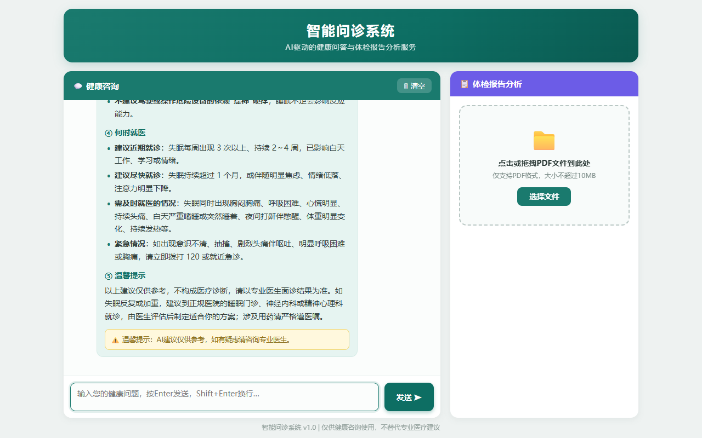
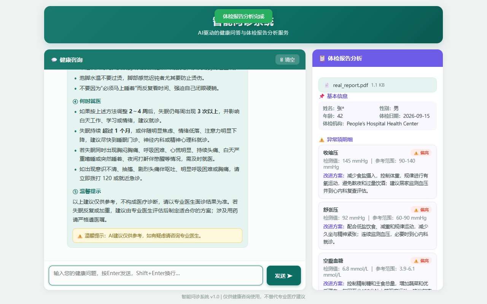

# AI 智能问诊系统

基于 DeepSeek 大模型的健康咨询与体检报告分析 Web 应用（学习项目，不构成医疗建议）。

## 功能特性

- **健康咨询（SSE 流式对话）**：后端将模型流式增量封装为 `start / token / done / error` 事件协议，前端原生 `fetch + TextDecoder` 逐字渲染；模型中断时保留已生成内容入库，历史不断档；同会话互斥锁防并发覆盖。
- **医疗安全护栏 Prompt**：强制「症状分析 / 缓解建议 / 需警惕事项 / 何时就医 / 温馨提示」五段式回答；急危重症先行提示拨打 120；不下诊断结论、不推荐处方药，全部回答附免责声明。
- **体检报告分析（异步任务）**：PDF 上传五重校验 + 路径穿越防护，`BackgroundTasks` 后台受理、前端轮询取结果；模型以 `json_object` 模式输出四段式结构化 JSON，代码侧做契约校验、偏高/偏低归一、姓名脱敏；原始文件阅后即焚，重启自动回收僵尸任务。
- **报告追问**：会话关联报告 ID，将报告摘要注入 system prompt，模型结合具体指标回答追问。
- **账号体系**：PBKDF2-SHA256 加盐哈希、X-Token 鉴权（7 天有效期）、会话与报告历史的分页/回看/删除/导出。

## 技术栈

Python · FastAPI · SQLite · DeepSeek API · httpx · Prompt 工程 · SSE · pypdf · 原生 HTML/CSS/JS

## 快速开始

```bash
# 1. 安装依赖（需先安装 uv）
cd backend
uv sync

# 2. 配置密钥：复制 .env.example 为 .env，填入你的 DeepSeek API Key
#    ⚠️ .env 已被 .gitignore 排除，切勿提交真实密钥

# 3. 启动后端（首次启动自动建表，并播种演示账号 admin / 123456）
uv run uvicorn main:app --port 8000

# 4. 打开前端：浏览器直接打开 frontend/index.html（或任意静态服务器）
```

## 项目结构

```
backend/    FastAPI 后端（main.py 路由入口，auth/llm/pdf 服务分层，schema.sql 建表）
frontend/   登录 / 注册 / 对话+报告 / 历史记录 四个页面（原生 JS）
test/       端到端冒烟测试脚本与界面截图
开发文档/    API 设计文档、数据库设计、业务术语表
需求文档/    PRD、各模块需求与用户故事
原型图/     页面原型
```

## 界面预览

| 对话与报告分析 | 历史记录 |
|---|---|
|  |  |

> 本项目为个人学习实践，所有健康相关内容仅供参考，不构成医疗诊断。
