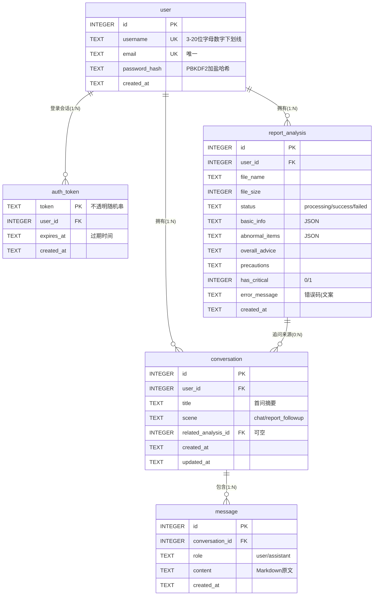

# 智能问诊系统 — 数据库设计文档

| 文档版本 | **V2.0**（依据全部需求文档重新设计） |
|----------|------|
| 编写日期 | 2026-10-18 |
| 部署数据库 | SQLite（实际文件 `backend/ai_clinic.db`）；MySQL 8.0 语法对照见第 8 章 |
| 关联需求 | 《PRD.md》FR-1～FR-18、《用户注册功能需求.md》《用户登录功能需求.md》《历史记录查看功能需求.md》《健康咨询模块需求.md》《体检报告分析模块PRD.md》 |
| 修订记录 | V1.0 三表无登录；V1.1 增 user 表补丁式修订；**V2.0 全面重设：登录态入库（auth_token）、业务表彻底改为 user_id 归属、删除 client_id 遗留列** |

---

## 1. 设计原则

1. **登录用户为唯一归属**：所有业务数据挂在 `user_id` 下（历史记录需求：仅本人可见）；不再保留浏览器 client_id 设计。
2. **隐私优先（R-BR-09）**：原始 PDF 不落盘、不存报告提取全文；`report_analysis` 仅存 AI 产出的结构化结果。
3. **密码安全（FR-15）**：`user.password_hash` 存加盐哈希（PBKDF2），全库无任何明文密码字段。
4. **最小够用**：半结构化结果（基本信息、异常项明细）整体读写、无行级查询需求 → JSON 文本列，不拆明细表。
5. **删除语义**：物理删除 + 级联（历史"删除后不可恢复"，FR-14/US-605）。
6. **建表顺序**：`user` → `auth_token` → `report_analysis` → `conversation` → `message`（外键指向先建表）。

## 2. ER 总览



---

## 3. 表结构明细与 DDL

### 3.1 user — 用户表（FR-15/FR-16）

| 字段 | 类型 | 约束 | 描述 |
|------|------|------|------|
| id | INTEGER | PK, AUTOINCREMENT | 用户 ID |
| username | TEXT | NOT NULL, UNIQUE | 用户名：3~20 位字母/数字/下划线（长度与字符集在应用层校验 4403，唯一索引兜底并发 4401） |
| email | TEXT | NOT NULL, UNIQUE | 邮箱：标准格式（应用层正则 4404），唯一索引兜底 4402 |
| password_hash | TEXT | NOT NULL | `pbkdf2_sha256$迭代数$盐(hex)$哈希(hex)` 格式，严禁明文 |
| created_at | TEXT | NOT NULL DEFAULT 当前本地时间 | 注册时间 |

```sql
CREATE TABLE IF NOT EXISTS user (
  id            INTEGER PRIMARY KEY AUTOINCREMENT,
  username      TEXT NOT NULL UNIQUE,
  email         TEXT NOT NULL UNIQUE,
  password_hash TEXT NOT NULL,
  created_at    TEXT NOT NULL DEFAULT (datetime('now','localtime'))
);
```

### 3.2 auth_token — 登录凭证表（FR-16/FR-17，V2.0 新增）

| 字段 | 类型 | 约束 | 描述 |
|------|------|------|------|
| token | TEXT | PK | 服务端颁发的不透明随机串（secrets.token_hex(32)，64 字符），随 `X-Token` 请求头传递 |
| user_id | INTEGER | NOT NULL, FK→user.id ON DELETE CASCADE | 凭证所属用户；删号凭证同灭 |
| created_at | TEXT | NOT NULL DEFAULT 当前本地时间 | 颁发时间 |
| expires_at | TEXT | NOT NULL | 过期时间（颁发时 +7 天；过期请求返回 4411） |

```sql
CREATE TABLE IF NOT EXISTS auth_token (
  token      TEXT PRIMARY KEY,
  user_id    INTEGER NOT NULL REFERENCES user(id) ON DELETE CASCADE,
  created_at TEXT NOT NULL DEFAULT (datetime('now','localtime')),
  expires_at TEXT NOT NULL
);
CREATE INDEX IF NOT EXISTS idx_token_user ON auth_token(user_id);
```

> 入库的意义：**重启服务不掉登录态**（纯内存 Token 重启即全员被踢），登出=DELETE 行，实现简单且可审计。

### 3.3 conversation — 咨询会话表（FR-2/FR-8/FR-18）

| 字段 | 类型 | 约束 | 描述 |
|------|------|------|------|
| id | INTEGER | PK, AUTOINCREMENT | 会话 ID |
| user_id | INTEGER | NOT NULL, FK→user.id ON DELETE CASCADE | **归属登录用户**（历史仅本人可见的依据） |
| title | TEXT | NOT NULL DEFAULT '新会话' | 列表标题：首问前 30 字摘要 |
| scene | TEXT | NOT NULL DEFAULT 'chat', CHECK IN ('chat','report_followup') | 普通咨询 / 报告追问（US-303） |
| related_analysis_id | INTEGER | NULL, FK→report_analysis.id | 追问关联的分析记录；普通会话为空 |
| created_at | TEXT | NOT NULL DEFAULT 当前本地时间 | 创建时间 |
| updated_at | TEXT | NOT NULL DEFAULT 当前本地时间 | 最后消息时间，**应用层维护**（SQLite 无 ON UPDATE） |

```sql
CREATE TABLE IF NOT EXISTS conversation (
  id                  INTEGER PRIMARY KEY AUTOINCREMENT,
  user_id             INTEGER NOT NULL REFERENCES user(id) ON DELETE CASCADE,
  title               TEXT NOT NULL DEFAULT '新会话',
  scene               TEXT NOT NULL DEFAULT 'chat' CHECK (scene IN ('chat','report_followup')),
  related_analysis_id INTEGER REFERENCES report_analysis(id),
  created_at          TEXT NOT NULL DEFAULT (datetime('now','localtime')),
  updated_at          TEXT NOT NULL DEFAULT (datetime('now','localtime'))
);
CREATE INDEX IF NOT EXISTS idx_conv_user_updated ON conversation(user_id, updated_at DESC);
```

### 3.4 message — 会话消息表（FR-1/FR-12）

| 字段 | 类型 | 约束 | 描述 |
|------|------|------|------|
| id | INTEGER | PK, AUTOINCREMENT | 消息 ID（兼会话内排序号） |
| conversation_id | INTEGER | NOT NULL, FK→conversation.id ON DELETE CASCADE | 所属会话 |
| role | TEXT | NOT NULL, CHECK IN ('user','assistant') | 消息角色 |
| content | TEXT | NOT NULL | 消息正文；AI 回复存 **Markdown 原文**（五段式），前端渲染 |
| created_at | TEXT | NOT NULL DEFAULT 当前本地时间 | 发送/完成时间 |

```sql
CREATE TABLE IF NOT EXISTS message (
  id              INTEGER PRIMARY KEY AUTOINCREMENT,
  conversation_id INTEGER NOT NULL REFERENCES conversation(id) ON DELETE CASCADE,
  role            TEXT NOT NULL CHECK (role IN ('user','assistant')),
  content         TEXT NOT NULL,
  created_at      TEXT NOT NULL DEFAULT (datetime('now','localtime'))
);
CREATE INDEX IF NOT EXISTS idx_msg_conv ON message(conversation_id, id);
```

> 上下文组装（C-BR、PRD 3.1）：取 `conversation_id` 下按 id 倒序最近 20 条反转，应用层截断。断流时已输出的半截回复也入库留痕（C-E4）。

### 3.5 report_analysis — 体检报告分析记录表（FR-3～FR-7/FR-9/FR-13/FR-18）

| 字段 | 类型 | 约束 | 描述 |
|------|------|------|------|
| id | INTEGER | PK, AUTOINCREMENT | 分析记录 ID |
| user_id | INTEGER | NOT NULL, FK→user.id ON DELETE CASCADE | **归属登录用户** |
| file_name | TEXT | NOT NULL | 展示用文件名（后端已清洗特殊字符，防路径穿越） |
| file_size | INTEGER | NOT NULL | 字节数（应用层校验 ≤10485760） |
| status | TEXT | NOT NULL DEFAULT 'processing', CHECK IN ('processing','success','failed') | 异步受理状态机 |
| basic_info | TEXT | NULL | 四段式①JSON：`{"name","gender","age","report_date","org"}`（name 入库前脱敏，如 `张*`） |
| abnormal_items | TEXT | NULL | 四段式②JSON 数组：`[{"name","value","ref","status","label","advice","critical"}]`，status ∈ high/low |
| overall_advice | TEXT | NULL | 四段式③总体健康建议（Markdown） |
| precautions | TEXT | NULL | 四段式④注意事项（含内容级免责声明） |
| has_critical | INTEGER | NOT NULL DEFAULT 0, CHECK IN (0,1) | 急危指标标记（R-BR-10，列表页 ⚠️ 展示） |
| error_message | TEXT | NULL | 失败信息，格式 `错误码\|用户文案`（如 `4106\|报告内容无法识别，请上传清晰 PDF`） |
| created_at | TEXT | NOT NULL DEFAULT 当前本地时间 | 分析时间（列表倒序） |

```sql
CREATE TABLE IF NOT EXISTS report_analysis (
  id             INTEGER PRIMARY KEY AUTOINCREMENT,
  user_id        INTEGER NOT NULL REFERENCES user(id) ON DELETE CASCADE,
  file_name      TEXT NOT NULL,
  file_size      INTEGER NOT NULL,
  status         TEXT NOT NULL DEFAULT 'processing'
                 CHECK (status IN ('processing','success','failed')),
  basic_info     TEXT,
  abnormal_items TEXT,
  overall_advice TEXT,
  precautions    TEXT,
  has_critical   INTEGER NOT NULL DEFAULT 0 CHECK (has_critical IN (0,1)),
  error_message  TEXT,
  created_at     TEXT NOT NULL DEFAULT (datetime('now','localtime'))
);
CREATE INDEX IF NOT EXISTS idx_rep_user_created ON report_analysis(user_id, created_at DESC);
```

> **不存清单（隐私设计）**：原始 PDF 二进制/路径（阅后即焚）、PDF 提取全文、任何明文密码。失败记录保留仅供当次轮询取错误文案，**不进历史列表**（US-304/4.3 只查 success）。

---

## 4. 需求 → 表/字段 追溯

| 需求 | 落点 |
|------|------|
| FR-1/FR-12 咨询消息与五段式回复 | message.content（Markdown 原文） |
| FR-2 会话管理/多轮上下文 | conversation + message；最近 20 条组装 |
| FR-8/FR-18 咨询历史（倒序、仅本人） | conversation.user_id + idx_conv_user_updated |
| FR-9/FR-18 分析历史（仅成功、倒序、仅本人） | report_analysis.user_id + status + idx_rep_user_created |
| FR-14 删除二次确认 | 后端 DELETE conversation/report_analysis（CASCADE） |
| FR-15 注册双唯一/密码哈希 | user.uk_username、uk_email、password_hash |
| FR-16/FR-17 登录态与退出 | auth_token（颁发/过期 4411/登出删除） |
| US-303 报告追问 | conversation.scene + related_analysis_id |
| R-BR-09 隐私 | 不存清单 + basic_info 脱敏 |
| R-BR-10 急危标记 | report_analysis.has_critical |

## 5. 典型查询与索引对照

| 场景 | SQL 形态 | 命中索引 |
|------|----------|----------|
| 会话列表 | `WHERE user_id=? ORDER BY updated_at DESC` | idx_conv_user_updated |
| 消息回看/组装 | `WHERE conversation_id=? ORDER BY id [DESC LIMIT 20]` | idx_msg_conv |
| 分析历史列表 | `WHERE user_id=? AND status='success' ORDER BY created_at DESC` | idx_rep_user_created |
| Token 鉴权 | `WHERE token=? AND expires_at > datetime('now','localtime')` | 主键 |
| 删除会话 | `DELETE WHERE id=? AND user_id=?`（CASCADE 清消息） | 主键 |

> 归属铁律：`user_id` 必须参与业务查询/删除条件；查不到（含他人数据）统一按 4302"记录不存在"响应，不泄露存在性。

## 6. 从现存 ai_clinic.db 迁移（V1.x → V2.0）

现存数据均为开发测试数据（三表 0 行），**无需数据迁移，直接重建**：删除库文件 → 按第 3 章 DDL 重建（执行顺序 user → auth_token → report_analysis → conversation → message）→ 开启 `PRAGMA foreign_keys = ON`。`backend/schema.sql` 同步替换为 V2.0 脚本。

## 7. 可选扩展表（需要您确认，默认不建）

| 候选表 | 用途 | 建议 |
|--------|------|------|
| `user_feedback` | 对 AI 回答点赞/点踩 | 当前需求文档未定义此功能，**不建** |
| `report_item`（异常项行级表） | 按指标跨报告查询/趋势图 | 现阶段异常项整体展示，JSON 已够；**不建**，有"指标趋势对比"需求时再拆 |
| `login_log` | 登录成功/失败审计 | 教学项目暂无审计需求；**不建**，生产环境可加 |

## 8. MySQL 对照（如需切换）

| SQLite（本设计/实际部署） | MySQL 8.0 |
|------------|-------------|
| INTEGER PRIMARY KEY AUTOINCREMENT | BIGINT AUTO_INCREMENT PRIMARY KEY |
| TEXT | VARCHAR(n) / TEXT / MEDIUMTEXT(message.content) |
| JSON 存 TEXT + 应用层序列化 | JSON 类型 |
| DEFAULT (datetime('now','localtime')) | DEFAULT CURRENT_TIMESTAMP（updated_at 可加 ON UPDATE） |
| CHECK 约束 | CHECK（8.0 生效）或 ENUM |
| TEXT 主键(token) | CHAR(64) |
